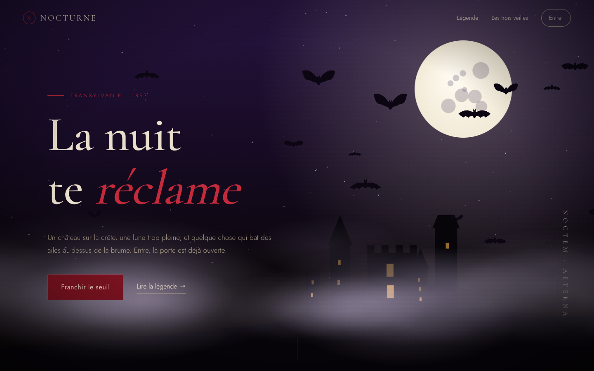
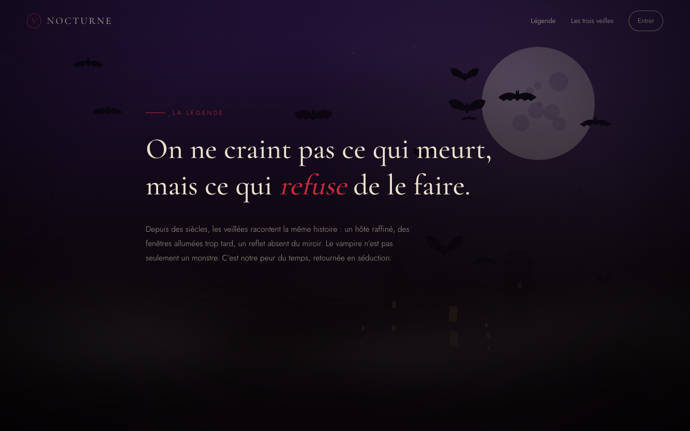
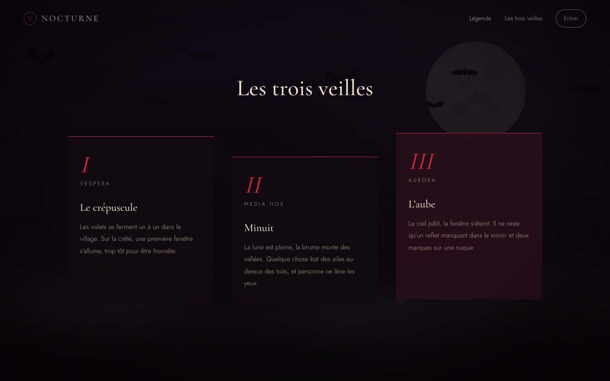
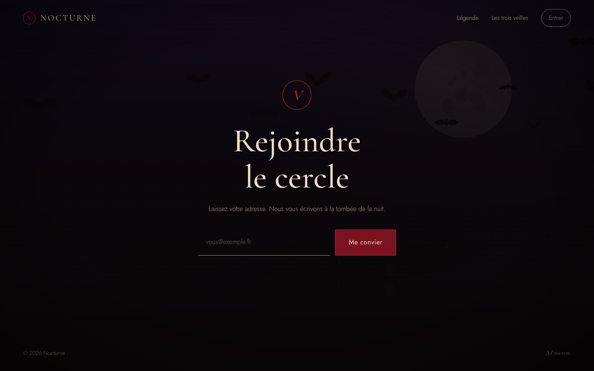
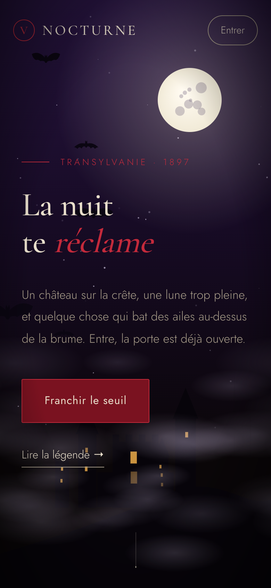

# Nocturne

A one-page gothic landing site built with Vue 3. A full moon hangs over a hilltop castle with flickering windows, mist rolls across the bottom of the screen, and bats fly past. The bats veer away from your cursor.



## What it does

- Everything in the background is drawn on a single canvas: stars that twinkle, a moon with a soft halo, a castle silhouette, three layers of drifting mist and the bats.
- The moon, castle and mist are painted once offscreen and reused on every frame. Only the stars, the castle windows, the mist offset and the bats change from frame to frame.
- Between 6 and 16 bats cross the screen in either direction, depending on screen size. Each has its own speed, wobble and wing beat, and the wings are redrawn on every frame.
- Move the pointer near a bat and it swerves away.
- The scenery fades as you scroll past the hero, so the text stays readable.
- If your system asks for reduced motion, the page draws one still frame and skips the animation.

| Legend | Three vigils | Sign-up |
| --- | --- | --- |
|  |  |  |

On phones the moon moves closer to the corner and the castle sits in the middle of the screen.



## Getting started

You need Node 20 or later and [pnpm](https://pnpm.io).

```bash
pnpm install
pnpm dev        # http://localhost:5173
pnpm build      # production build in dist/
pnpm preview    # serve the production build
```

## Project layout

```
src/
├── night/               # canvas engine, no Vue dependency
│   ├── scene.js         # animation loop, resize handling, scroll fade
│   ├── moon.js          # moon disc and halo
│   ├── castle.js        # castle silhouette and window flicker
│   ├── mist.js          # wrapping mist layers
│   ├── stars.js         # twinkling stars
│   ├── bat.js           # bat movement, pointer avoidance, drawing
│   ├── palette.js       # colours
│   └── random.js        # seeded PRNG
├── components/          # one component per page section
├── directives/reveal.js # v-reveal: fade in on first scroll into view
├── content.js           # copy for the three vigils
└── style.css            # design tokens and shared styles
```

The engine in `src/night/` doesn't depend on Vue. `NightCanvas.vue` creates the scene on mount and calls `destroy()` on unmount, so you can reuse the engine in another project.

## Tweaking it

- Colours and fonts are CSS variables at the top of `src/style.css`. Canvas colours are in `src/night/palette.js`.
- Bat count and the pointer avoidance radius are constants at the top of `src/night/scene.js` and `src/night/bat.js`.
- The castle layout comes from the seed in `src/night/castle.js`. Change `SEED` or edit the `tower` calls to build a different skyline.
- The copy is in French. Edit `src/content.js` and the section components to change it.

## Notes

The sign-up form is a demo and doesn't send anything. Fonts load from Google Fonts.

## License

MIT
